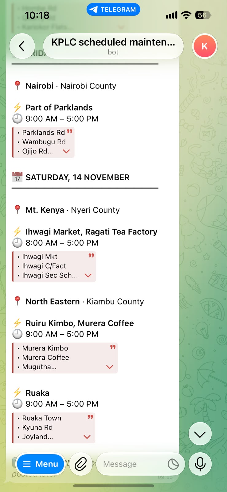

<h1 align="center">Hi, I'm George 👋</h1>

  <b>Data engineer with a cloud infrastructure background.</b> 
  I build data platforms from the ground up: the network and servers, the databases, and the pipelines on top.

  
  
  
  
  
   
  
  
  
  
  

---

## ☁️ Cloud and data infrastructure

**Now: PostgreSQL and Linux in production.** My focus these days is databases and the data flowing through them: keeping it fast, reliable, and worth trusting.

**Before: Azure, across the whole stack.** I designed, built and ran data platforms on Azure, from architecture and networking through administration to data engineering.

- **Architecture and networking.** Environments designed end to end: virtual networks, subnets and network security groups, identity and access through Entra ID, and compute and storage sized to the workload and to the budget.
- **Infrastructure as code.** Whole environments defined in Terraform (`azurerm`, `azuread`): resource groups, ADLS Gen2 lakes, VNets, Linux VMs with managed disks and scheduled auto-shutdown, and the service principals the pipelines authenticate as.
- **Data platforms.** Data lakes on ADLS Gen2, event-driven ingestion with Azure Functions blob triggers, tooling to audit lake contents at scale, and ETL in Python and SQL feeding reporting databases and dashboards.

## ⚡ Side project: Kenya Power Tracker

<table>
  <tr>
    <td width="270" valign="top">
      
    </td>
    <td valign="top">
      
Kenya Power publishes planned outages as PDFs that nobody can search or subscribe to. This project reads every notice each hour, turns it into structured data (1,400+ outages parsed so far in 2026), and serves it through a Telegram bot.

      
Follow your area with <code>/subscribe</code> and the bot messages you when a new notice lists it. Matching is fuzzy enough to catch KPLC's spellings ("Dagoretti" finds "Dagoreti").

      
It runs entirely on free tiers.

      
<b>Try it:</b> <a href="https://t.me/kplc_tracker_bot">@kplc_tracker_bot</a>

      
<i>Python · pdfplumber · GitHub Actions · Cloudflare Workers + D1</i>

    </td>
  </tr>
</table>

---

- 👯 Open to collaborating on data engineering and cloud infrastructure work
- 💬 Ask me about Azure, PostgreSQL in production, Terraform, and parsing messy documents into clean data

  
  

