### Hi there 👋
I am George Owino, a data enthusiast. I seek data, do magic on it then store or serve it to other people who need it.  I try to make as accurate deductions about what those numbers tell as possible. More importantly, I setup the infrastrure on which the data and systems utilizing this data run.

<!--
**vkoll29/vkoll29** is a ✨ _special_ ✨ repository because its `README.md` (this file) appears on your GitHub profile.

Here are some ideas to get you started:

- 🔭 I’m currently working on ...
- 🌱 I’m currently learning ...
- 👯 I’m looking to collaborate on ...
- 🤔 I’m looking for help with ...
- 💬 Ask me about ...
- 📫 How to reach me: ...
- 😄 Pronouns: ...
- ⚡ Fun fact: ...
-->

- 🔭 I’m currently working on an automation concept using Terraform, Twitter API, Azure Cognitive Services, Telegram Bot API, and MongoDB. 
- 🌱 I'm also learning containerization and MLOps 
- 👯 I'd like to collaborate on infrastructure related work
- 💬 Ask me about data engineering and infra

